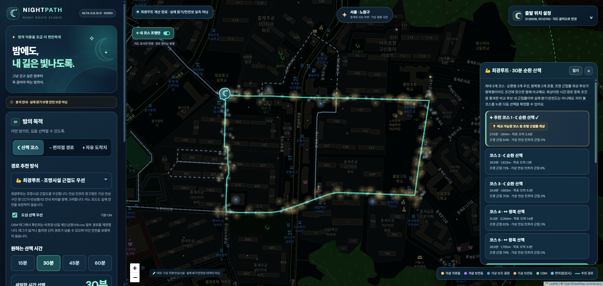

# NIGHTPATH 🌙

**밤길의 조명시설 위치와 보행망을 함께 살펴보고, 사용자가 야간 이동·산책 경로를 비교해 선택할 수 있도록 만든 연구용 웹 프로토타입입니다.**

**프로젝트 버전:** `v0.8.13.0` (2026-11-14, 자유 도착지 시험판 / `v0.8.12.9` 안정판 보존)  
**배포 상태:** GitHub Pages 공개 데모 운영 중 · **데스크톱 웹 브라우저 최적화**  
**체험 링크:** **[🌙 NightPath 웹 데모 바로가기](https://neptunus7.github.io/NightPath/)**

## 🌙 실제 웹 데모 화면



> **🖥️ 실행 환경:** PC/데스크톱 브라우저에서 지도, 조명 시각화, 경로 및 비교 패널을 가장 편리하게 이용할 수 있도록 설계했습니다. 모바일에서도 접속할 수 있지만 좁은 화면에서는 조작이 불편할 수 있습니다. 별도 설치 없이 브라우저에서 실행됩니다.
>
> **📌 화면 안내:** 이 이미지는 2026-11-14에 캡처한 **공개 웹 데모의 실제 실행 화면**입니다. 공개 데모는 실제 OSM 도로·편의점 위치와 **가상 조명·가상 안심시설 정보**를 사용합니다. 보이는 빛의 번짐과 경로 점수는 측정된 밝기(lux), 실제 점등 상태 또는 보행 안전을 나타내지 않습니다.

## 공개 데모와 실제 데이터 분석의 차이

- **공개 웹 데모 (`docs/`):** 실사용 가능한 UI·경로 탐색을 시연하며, OSM 도로·편의점 기록 및 합성(가상) 조명·안심시설 데이터를 사용합니다.
- **로컬 개발·연구:** 별도 확보한 2025년 국토지리정보원 수치지도에서 추출한 조명 위치 기록으로 분석과 경로 모델 검증을 수행했습니다.
- **공개하지 않은 자료:** 국토지리정보원 원본 도엽과 그로부터 추출한 실제 조명 좌표, 이용·국외반출 조건을 확정하지 못한 기타 실좌표는 GitHub에 올리지 않았습니다. 가상 조명은 실측 시설 배치의 대체물이 아닙니다.

> ⚠️ NIGHTPATH는 야간 경로 선택을 위한 연구·포트폴리오 시연작으로, 현재 조도나 점등 상태·보행 가능 여부·안전을 보장하거나 공식 안전 정보를 제공하지 않습니다.

## 새로운 자유 도착지 기능 (v0.8.13.0 시험판)

기존 출발점에서 사용자가 지도에 찍은 도착지까지 **거리 우선/조명시설 근접도 우선** 경로를 비교합니다. 조명 우선은 기준 경로 대비 최대 35% 우회하는 평가 후보 중 하나입니다. 두 경로가 같으면 한 경로라고 표시하고, 도로망 미연결·범위 밖이면 경로를 만들지 않습니다. 노드까지의 연결 구간은 실제 보행 경로로 검증되지 않았습니다. 자세한 사항은 [기능 검증 및 한계](docs/FREE_DESTINATION_v0.8.13.0.md)를 참고하세요.

## 1. 왜 만들었나

NIGHTPATH는 새벽 귀갓길에서 겪었던 개인적인 경험에서 시작됐습니다.

새벽 4시쯤 편의점에서 음료를 사서 자취방으로 돌아가고 있었습니다. 길에서 모자를 깊게 눌러쓴 사람과 마주쳐 지나쳤는데, 잠시 후 뒤에서 인기척이 느껴졌습니다. 곁눈질로 살펴보니 누군가 주변을 살피거나 딴청을 부리는 듯한 모습으로 뒤따라오는 것 같았습니다.

그 길은 밤이면 정말 어두웠습니다. 가로등도 띄엄띄엄 설치되어 있었고, 뒤를 의식하며 걷는 동안 심장이 빠르게 뛰고 식은땀이 날 정도로 두려웠습니다.

집으로 돌아가는 길에는 오른쪽으로 꺾이는 골목이 있었습니다. 조금 빠르게 모퉁이를 돌자 뒤쪽이 보이지 않았고, 그때 무언가 바닥에 떨어지는 듯한 소리가 들렸습니다. 불안한 마음으로 계속 걸어 집 근처에 다다랐을 무렵, **방금 지나온 모퉁이 쪽에서 갑자기 아주 큰 박수 소리가 들렸습니다.**

집 앞은 비교적 밝은 큰길 근처였고, CCTV·비상벨·조명이 결합된 시설도 있었습니다. 그 환경 때문에 상대가 더 가까이 오지 않았던 걸까 하는 생각도 들었지만, **실제로 누가 어떤 의도로 행동했는지는 알 수 없습니다.** 그날 이후 한동안 어두워지면 외출하는 것이 꺼려졌습니다.

그러다 이런 질문을 떠올렸습니다.

> **그날 주변에서 조명시설이 많은 길을 미리 알 수 있었다면, 다른 길을 선택할 수 있지 않았을까?**

가까운 편의점 A로 가는 길이 어둡다면, 조금 더 멀더라도 조명시설이 많은 길에 있는 편의점 B를 고를 수 있지 않을까? 목적지가 같아도 다른 경로로 이동할 수 있지 않을까? 이 생각에서 조명시설 위치를 지도에 시각화하고 여러 경로를 비교하는 NIGHTPATH를 구상했습니다.

평소 저와 가족들이 저녁 산책을 즐긴다는 점도 개발 방향에 영향을 줬습니다. 단순히 목적지까지 이동하는 것을 넘어, **원하는 시간만큼 걸을 수 있는 산책 코스를 추천하는 기능**으로 확장했습니다.

처음에는 실제 경험이 있었던 분당 지역에서 개발을 시작했습니다. 하지만 확보할 수 있는 조명 데이터가 부족해 여러 경로를 비교하기 어려웠습니다. 서울 전체를 구현하고 싶었지만, 우선 데이터를 확보하고 반복해서 확인할 수 있는 **노원구의 약 1km 생활권**으로 시험 범위를 옮겼습니다. 제가 가족과 평소 산책하는 범위이기도 했습니다.

개발한 뒤에는 직접 NIGHTPATH를 이용해 몇 차례 산책을 다녀왔습니다. 평소 좋아하던 코스의 어두운 구간에서 멀지 않은 곳에 조명시설이 많은 구간을 발견해 그쪽으로 걸어보기도 했고, 여러 추천 코스 중 오늘 걸을 길을 뽑듯 고르는 재미도 느꼈습니다. 다만 개인적인 사용 경험이 **실제 조도나 보행 안전성을 검증했다는 뜻은 아닙니다.**

아직 처음 구상했던 모든 기능을 구현한 것은 아닙니다. 특히 **상점의 실제 영업시간을 고려해 시간대마다 달라지는 도시의 빛을 표현하는 기능**을 완성하지 못한 점이 가장 아쉽습니다. 앞으로는 경유지를 거쳐 돌아오는 산책 코스, 야경을 볼 만한 목적지, 다양한 광원을 표현하는 방향으로 발전시키고 싶습니다.

**NIGHTPATH는 밤길의 안전을 보장하는 서비스가 아닙니다. 밤에 걷는 사람이 주변 환경을 미리 살펴보고 스스로 다른 길을 선택할 수 있도록 돕기 위한 시도입니다.**

## 2. 구현 내용

| 기능 | 현재 구현 | 정확한 의미 |
|---|---|---|
| 조명 시각화 | 공개 데모는 **가상 조명** 및 시각 효과, 로컬 연구는 실제 시설 기록을 별도로 활용 | 빛 효과는 연출이며 실제 점등·조도 아님 |
| 최광루트 | 조명시설 접근성을 우선한 경로 추천 | 모델에서 정의한 **근접 지표** 기준 |
| 안심 인프라 참고형 | 로컬 연구는 2022년 기록 참고, 공개 데모는 **가상 시설**로 시연 | 실제 시설 운영·안전성을 의미하지 않음 |
| 시간 지정 산책 | 5~60분, 순환형 우선, 왕복형 보완, 최대 5개 | 예상 시간·중복 제약은 모델 추정 |
| 편의점 경로 | 위치 기반 추천, 가까운 점포 후보 반영 | 영업 여부·진짜 매장 조명 확인되지 않음 |
| 자유 도착지 (v0.8.13.0 시험판) | 지도에서 목적지 지정, 거리 우선/조명 근접 우선 비교, 확정·취소 | OSM 도로망 연결점까지의 모델; 실제 보행·조도 미검증 |
| 결과창/경로 확정 | 후보 비교·선택·취소·상세 창 접기 | 사용자 피드백으로 개선한 UI |

로컬 개발·연구판에서는 조명시설 위치 **9,193건(2025년 도엽 자료 기준)**을 분석에 사용했습니다. **이 좌표들은 공개 웹 데모에는 포함되지 않습니다.** 이는 실제 점등 중인 가로등 9,193개를 뜻하지 않습니다. 1km 기준 도엽 범위의 약 97.17%를 확보했다는 수치도 **시설 전수·안전 커버리지**가 아닙니다.

## 3. 기술 구성

- **UI:** 정적 HTML/CSS, JavaScript ES Modules, [Leaflet 1.9.4](https://leafletjs.com/) 지도 렌더링
- **경로:** OSM 보행 후보 그래프, 반복 구간/시간/시설 근접도 가중치, 순환·왕복 후보 필터링
- **배포:** GitHub Pages 정적 웹사이트 (`docs/index.html`)
- **서버/데이터 준비:** Python `http.server` 기반 로컬 개발 서버 및 별도 전처리 스크립트
- **라이선스 구분:** 자체 코드 MIT / OSM 지도 데이터 ODbL / Leaflet BSD-2-Clause / 지도 타일 별도 이용 정책 / 국내 공공데이터는 해당 기관 조건과 측량성과 국외반출 제한 검토

```text
nowon/
  index.html, app.mjs, routing.mjs, light_canvas.mjs
  style.css, store_hours.mjs, store_recommendations.mjs
  free_destination.mjs  # 도착지 스냅·거리/조명 비교
  data_prep/        # 소스 데이터는 미포함. 로컬에서 직접 처리
  data/.gitkeep      # 공개 코드의 로컬 재현용 실좌표 미포함
examples/            # 인공적인 예제 데이터만 사용
scripts/             # 공개 전 누출 검사
tests/              # 공개 가능한 가상 그래프/모의 데이터 테스트
docs/               # GitHub Pages 공개 데모 + 출처·한계·검증 문서
```

## 4. 웹 데모 실행 및 공개 코드 확인하기

### 🌐 브라우저에서 바로 체험

**[NightPath 공개 웹 데모 열기](https://neptunus7.github.io/NightPath/)**

- PC 브라우저 권장. 휴대폰에서도 접속할 수 있지만 데스크톱 화면을 기준으로 개발했습니다.
- `docs/index.html`은 실제 OSM 기반 도로·편의점 위치와 **가상 조명·가상 안심시설**로 작동하는 공개 시연판입니다.
- `nowon/`은 기존 로컬 연구 코드 구조를 보존한 폴더입니다. `nowon/data/`에는 허가 미확인 실좌표가 포함되지 않아 이 폴더만으로 연구판을 그대로 재현할 수는 없습니다.
- 공개용 데모의 조명 배치와 근접 지표는 실제 가로등 위치나 야간 밝기를 뜻하지 않습니다.

### 🧪 알고리즘 테스트

실제 조명 좌표를 공개하지 않고도 핵심 알고리즘은 **가상 보행 그래프 테스트**로 확인할 수 있습니다.

```bash
# Node.js 설치 후, 프로젝트 루트에서
node examples/synthetic_route_demo.mjs
node --test tests/*.test.mjs
python -m unittest discover -s tests -p 'test_*.py'
python scripts/audit_public_repo.py
```

`nowon/`의 개발용 재현에는 합법적으로 확보한 별도 입력 자료가 필요하며, 원본 수치지도와 실제 추출 좌표를 GitHub에 추가하지 않습니다. 공개 배포와 로컬 연구 환경은 서로 구분해 관리합니다.

## 5. 검증과 의사결정

- 약 41개 1:1,000 수치지도 도엽의 `C0220000` 조명 레이어 확인, 중복 ID 및 위치 좌표 점검
- OSM 도로 태그 기반 야간 도심 산책 제한(계단/비포장/산길 등), 추천 시간과 반복률 검토
- 순환형 5개가 차도 조명 근접률 최상 왕복 후보를 가리지 않도록 비교 후보군 설계 개선
- 실제 PC에서 `v0.8.12.9` 정상 작동 확인(사용자 확인), `v0.8.13.0` 자유 도착지 기능도 자동 테스트 및 사용자 PC 동작 확인, 다만 **실측 조도·실제 보행·시설 운영 검증은 별개**

세부 내용: [방법과 한계](docs/METHOD_AND_LIMITATIONS.md) · [기획 과정](docs/PROJECT_STORY.md) · [버전 기록](CHANGELOG.md)

## 6. 출처·공개 범위

공개 웹 데모의 OSM 기반 도로·편의점 위치 데이터는 © OpenStreetMap contributors, [ODbL 1.0](https://www.openstreetmap.org/copyright). 공개용 데이터의 세부 고지는 [GitHub Pages 데이터·라이선스 안내](docs/PAGES_DATA_LICENSE.md)에서 확인할 수 있습니다. Leaflet은 BSD-2-Clause입니다. 대한민국 국토지리정보원의 수치지도는 공공누리 제1유형으로 안내되나 **별도의 국외반출 규정을 검토해야 하므로 해당 원본과 수치지도에서 추출한 실제 조명 좌표는 이 공개 저장소에서 제외했습니다.**

[데이터별 공개 판단표](docs/DATA_POLICY.md) · [3자 고지](docs/THIRD_PARTY_NOTICES.md) · [공개 전 검사](docs/PUBLISH_CHECKLIST.md)

**개발 환경 안내:** NightPath의 시연 UI는 데스크톱(PC) 화면에 최적화되어 있습니다. 모바일 접속은 가능하지만 일부 조작이 불편할 수 있습니다.

> 이 프로젝트는 야간 길 찾기 서비스의 기술적 가능성을 검토하기 위한 포트폴리오 연구작입니다. 공식 안전 안내 서비스가 아닙니다.
